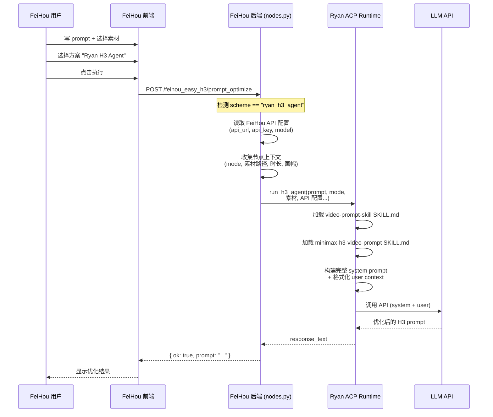
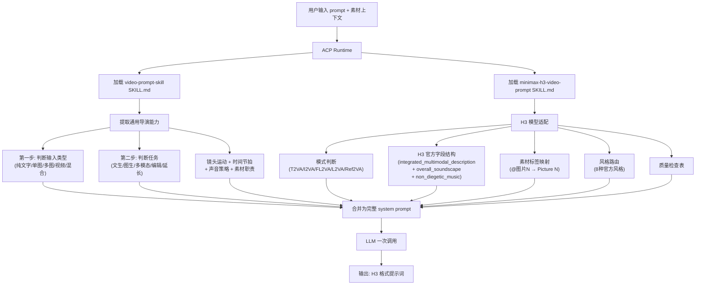

# 将 Ryan ACP H3 Agent 集成到 ComfyUI-FeiHou-Easy-H3

## 背景

ComfyUI-FeiHou-Easy-H3 的内置提示词优化是简单的 "system prompt + 用户原始 prompt → LLM 一次调用" 模式，system prompt 来自 `prompt_guides/` 目录下约 2KB 的 guide.md。

Ryan_Comfy_Utils 的 H3 提示词 Agent 则是完整的 ACP 智能体：两层 Skill（通用视频 prompt 引擎 + H3 模型适配层）提供约 56KB 的导演知识，支持素材理解、模式判断、时间线编排、镜头设计、声音策略、风格路由和质量自检。

目标是将 Ryan 的 ACP Agent 能力嵌入 FeiHou 插件，让 FeiHou 用户无需切换节点即可获得更强的提示词优化。

## 已确认的设计决策

| # | 决策 | 结论 |
|---|------|------|
| 1 | 集成方式 | FeiHou 内部调用 Ryan 的 ACP 运行时 |
| 2 | Skill 执行顺序 | 单次 LLM 调用，两层 Skill 合并为完整 system prompt |
| 3 | 调用方式 | ACP Agent 完整能力（Skill + LLM 推理 + 素材理解） |
| 4 | 依赖方式 | Python import (`import ryan_comfy_utils.acp.runtime`) |
| 5 | API 配置 | 复用 FeiHou 设置页已配置的 Provider API |
| 6 | 用户入口 | 新增内置 scheme "Ryan H3 Agent" |
| 7 | 上下文传递 | 自动读取 FeiHou 主节点全部上下文（mode/素材/时长/画幅） |
| 8 | Skill 加载策略 | 两层串行：video-prompt-skill + minimax-h3-video-prompt |
| 9 | Manifest | 新建 `feihou_h3_agent.json` 专用 manifest |
| 10 | UI / 错误处理 | 设置页专门 UI 区块 + graceful fallback |

---

## User Review Required

> [!IMPORTANT]
> **video-prompt-skill 裁剪范围**：完整的 video-prompt-skill 有 826 行 (~50KB)，其中 Combat 引擎约占 60%。计划裁剪掉 Combat 相关内容后合并。但这意味着 FeiHou 版 Agent 不支持复杂格斗/武侠动作编排。请确认是否可以接受。

> [!WARNING]
> **双插件依赖**：选中 "Ryan H3 Agent" 方案时，FeiHou 将通过 `import ryan_comfy_utils.acp.runtime` 调用 ACP 运行时。这要求两个插件同时安装。未安装 Ryan_Comfy_Utils 时该方案自动隐藏，不影响 FeiHou 原有功能。

## Open Questions

> [!IMPORTANT]
> 1. **video-prompt-skill 的 references 目录**：该 Skill 有大量 references（inputs/tasks/controls/libraries/styles/models/diagnostics），ACP 运行时在执行时会按需读取。FeiHou 集成版是否需要支持这些 references 的按需加载？还是只用 SKILL.md 本体作为 system prompt？
>    - 如果支持 references → 完整 ACP 能力，但 context window 消耗大
>    - 如果不支持 → 只用 SKILL.md 核心规则，更快但深度降低

> [!IMPORTANT]
> 2. **FeiHou 的节点上传/持久化**：FeiHou 的媒体上传后存在 ComfyUI input 目录。ACP Agent 需要读取这些图片来做 VLM 分析。是否允许 ACP 读取 FeiHou 节点已上传的媒体文件路径？

---

## Proposed Changes

### Ryan_Comfy_Utils 侧

#### [NEW] [feihou_h3_agent.json](file:///X:/ComfyUI-aki-v2/ComfyUI/custom_nodes/Ryan_Comfy_Utils/ryan_comfy_utils/acp/fixtures/manifests/feihou_h3_agent.json)

新建专用 manifest，定义：
- 绑定两个 Skill：`video-prompt-skill`（通用导演引擎）+ `minimax-h3-video-prompt`（H3 适配层）
- `context_template`：接收 FeiHou 传入的上下文变量（generation_mode、素材清单、时长、画幅、参考图尺寸）
- `result_mapping`：提取 `response_text`（优化后的 H3 prompt）

```json
{
  "name": "FeiHou H3 Agent",
  "description": "Ryan ACP Agent for FeiHou-Easy-H3 prompt optimization",
  "skills": [
    {"skill_id": "video-prompt-skill", "role": "primary"},
    {"skill_id": "minimax-h3-video-prompt", "role": "adapter"}
  ],
  "context_template": "...(含 FeiHou 上下文占位符)...",
  "result_mapping": {
    "response_text": "$.content"
  }
}
```

> [!NOTE]
> manifest 的具体 context_template 需要根据 ACP 运行时的 Skill 拼接机制确认。当前 ACP 的 `execute_text_session` 已支持 `skill_root` + `skill_id` 绑定，但两个 Skill 的串行加载可能需要扩展 manifest schema。

---

#### [NEW] [feihou_bridge.py](file:///X:/ComfyUI-aki-v2/ComfyUI/custom_nodes/Ryan_Comfy_Utils/ryan_comfy_utils/acp/feihou_bridge.py)

暴露一个干净的 Python API 供 FeiHou 调用：

```python
def run_h3_agent(
    *,
    user_prompt: str,
    generation_mode: str,      # "T2VA" | "I2VA" | "FL2VA" | "L2VA" | "Ref2VA"
    task_relation: str,        # "无" | "Video Editing" | "Video Continuation" | ...
    media_resources: list,     # [{"type": "image", "path": "...", "role": "首帧"}, ...]
    duration_seconds: float,
    aspect_ratio: str,
    ref_image_short_edge: int,
    # LLM API 配置（从 FeiHou 设置传入）
    api_url: str,
    api_key: str,
    api_format: str,           # "openai" | "gemini" | "ollama"
    model: str,
    temperature: float = 0.7,
    max_tokens: int = 4096,
    top_p: float = 0.9,
) -> str:
    """执行 ACP H3 Agent 并返回优化后的 H3 prompt。"""
```

内部逻辑：
1. 从 FeiHou 的 API 配置构建临时 `runner_profile`
2. 将 FeiHou 的上下文（mode/素材/时长/画幅）格式化为 `_build_h3_extra_lines` 等效的 user context
3. 调用 `execute_text_session` 执行 ACP session
4. 返回 `response_text`

---

### ComfyUI-FeiHou-Easy-H3 侧

#### [MODIFY] [nodes.py](file:///X:/ComfyUI-aki-v2/ComfyUI/custom_nodes/ComfyUI-FeiHou-Easy-H3/nodes.py)

**变更 1：新增 Ryan ACP 桥接 (soft import)**

在模块顶部添加：

```python
# Ryan ACP Agent integration (optional dependency)
try:
    from ryan_comfy_utils.acp.feihou_bridge import run_h3_agent as _ryan_h3_agent
    _RYAN_ACP_AVAILABLE = True
except ImportError:
    _ryan_h3_agent = None
    _RYAN_ACP_AVAILABLE = False
```

**变更 2：在 scheme 列表中注入 "Ryan H3 Agent"**

修改 `_public_prompt_optimizer_schemes()` 函数 ([L715](file:///X:/ComfyUI-aki-v2/ComfyUI/custom_nodes/ComfyUI-FeiHou-Easy-H3/nodes.py#L715))：

```python
def _public_prompt_optimizer_schemes(value):
    # ... 现有 builtin + custom schemes ...
    
    # 仅当 Ryan_Comfy_Utils 已安装时注入
    if _RYAN_ACP_AVAILABLE:
        schemes.insert(0, {
            "id": "ryan_h3_agent",
            "name": "Ryan H3 Agent",
            "name_zh": "Ryan H3 智能体",
            "prompt": "",  # 不使用静态 prompt，走 ACP 管线
            "editable": False,
        })
    return schemes
```

**变更 3：在提示词优化路由中分流**

修改 `_run_configured_prompt_optimizer()` 函数 ([L1484](file:///X:/ComfyUI-aki-v2/ComfyUI/custom_nodes/ComfyUI-FeiHou-Easy-H3/nodes.py#L1484))：

```python
def _run_configured_prompt_optimizer(prompt, mode, seconds, service_model, scene_guide, ...):
    config = _read_prompt_optimizer_config()
    
    # Ryan ACP Agent 分流
    resolved_scene_guide, custom_prompt = _optimizer_scheme(config, scene_guide)
    if scene_guide == "ryan_h3_agent" and _RYAN_ACP_AVAILABLE:
        provider = _active_optimizer_provider(config, service_model)
        return _run_ryan_h3_agent(
            prompt=prompt,
            mode=mode,
            seconds=seconds,
            resources=resources,
            provider=provider,
            reference_short_edge=reference_short_edge,
        )
    
    # 原有逻辑不变
    ...
```

**变更 4：新增 Ryan Agent 执行函数**

```python
def _run_ryan_h3_agent(
    prompt, mode, seconds, resources, provider, reference_short_edge
):
    """调用 Ryan ACP Agent 完成提示词优化。"""
    # 构建媒体资源列表
    media_resources = []
    for resource in (resources or []):
        path = _optimizer_asset_path(resource.get("asset", {}))
        if path:
            media_resources.append({
                "type": resource.get("type", "image"),
                "path": path,
                "tag": resource.get("tag", ""),
            })
    
    # 映射 FeiHou mode → Ryan generation_mode
    mode_map = {
        "image": "T2VA",
        "reference": "Ref2VA",
    }
    
    result = _ryan_h3_agent(
        user_prompt=prompt,
        generation_mode=mode_map.get(mode, "T2VA"),
        task_relation="无",
        media_resources=media_resources,
        duration_seconds=seconds,
        aspect_ratio="",  # 从节点上下文获取
        ref_image_short_edge=int(reference_short_edge or 480),
        api_url=str(provider.get("api_url", "")),
        api_key=str(provider.get("api_key", "")),
        api_format=str(provider.get("api_format", "openai")),
        model=str(provider.get("llm_model") or provider.get("vlm_model", "")),
        temperature=float(provider.get("temperature", 0.7)),
        max_tokens=int(provider.get("max_tokens", 4096)),
        top_p=float(provider.get("top_p", 0.9)),
    )
    return result, str(provider.get("id", "")), str(provider.get("llm_model", ""))
```

---

#### [MODIFY] [feihou_easy_h3_settings_and_lora.js](file:///X:/ComfyUI-aki-v2/ComfyUI/custom_nodes/ComfyUI-FeiHou-Easy-H3/web/feihou_easy_h3_settings_and_lora.js)

**在提示词优化规则区域新增 Ryan H3 Agent 状态区块**：

当 schemes 列表中包含 `ryan_h3_agent` 时（即后端检测到 Ryan_Comfy_Utils 已安装），在规则表格上方显示一个状态卡片：

```
┌──────────────────────────────────────────────────┐
│ 🤖 Ryan H3 Agent                                │
│                                                  │
│ 状态: ✅ 已就绪 (Ryan_Comfy_Utils 已安装)        │
│ Skill: video-prompt-skill + minimax-h3-video-prompt│
│ 能力: 素材理解 | 模式判断 | 时间线编排 | 风格路由  │
│                                                  │
│ ℹ️ 选中此方案后，提示词优化将使用完整的 ACP 智能体 │
│    而非简单的 system prompt + LLM 一次调用。      │
└──────────────────────────────────────────────────┘
```

如果 `ryan_h3_agent` 不在 schemes 中（未安装 Ryan_Comfy_Utils），不显示任何内容。

---

## 架构流程图



## Skill 执行顺序设计



## Verification Plan

### Automated Tests

```bash
# 在 Ryan_Comfy_Utils 中测试桥接函数
cd X:\ComfyUI-aki-v2\ComfyUI\custom_nodes\Ryan_Comfy_Utils
python -m pytest tests/ -k "feihou_bridge" -v

# 测试 FeiHou 的 soft import 和 scheme 注入
cd X:\ComfyUI-aki-v2\ComfyUI\custom_nodes\ComfyUI-FeiHou-Easy-H3
python -c "from nodes import _RYAN_ACP_AVAILABLE; print(f'Ryan ACP: {_RYAN_ACP_AVAILABLE}')"
```

### Manual Verification

1. **Scheme 可见性**：启动 ComfyUI → 设置 → 🐵Easy H3 → 检查提示词优化规则列表中是否出现 "Ryan H3 Agent"
2. **T2VA 测试**：选择 "Ryan H3 Agent" → 输入简单创意 → 执行 → 检查输出是否为完整的 H3 `integrated_multimodal_description` + `overall_soundscape` + `non_diegetic_music` 结构
3. **Ref2VA 测试**：上传多张图片 + 视频 → 选择参考模式 → 执行 → 检查输出是否为完整的 `subject_definitions` + `summary` + `retention_analysis` + `detailed_description` + `overall_soundscape` + `non_diegetic_music` 结构
4. **Fallback 测试**：临时重命名 Ryan_Comfy_Utils 目录 → 重启 ComfyUI → 检查 "Ryan H3 Agent" 方案不再出现，原有方案正常工作
5. **UI 状态**：检查设置页中 Ryan H3 Agent 状态卡片的显示
